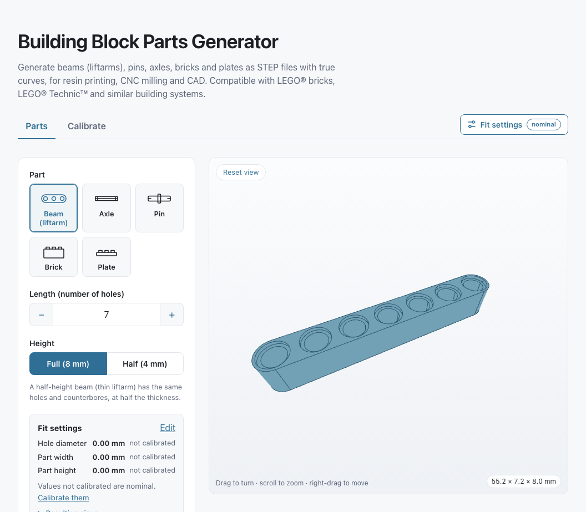

# Building Block Parts Generator

Browser app for designing parts for building-block construction systems and
downloading them as CAD files with true curves, ready for 3D printing or CNC
machining. Calibrate the fit to your own machine and preview each part in 3D.
Written in TypeScript with replicad, and runs entirely client-side.

**Use it at <https://blockparts.vegardmakes.com>.**

It generates parts compatible with LEGO® bricks, LEGO® Technic™ and similar
building systems: beams (liftarms) of full or half height, axles and pins, bricks
and plates, plus calibration parts that find the fit for your printer or CNC
machine. Calibrate once, choose the size, preview the part in 3D and download a
STEP file (or an STL mesh) for resin printing or CNC machining.

Everything runs in the browser. There is no server-side back end: the CAD
kernel (OpenCascade, compiled to WebAssembly and used through replicad) runs in
a Web Worker.

Unlike mesh-based tools, the STEP files contain true curves. Holes are real
cylinders with circular edges, not polygons made of line segments.



## Features

- Pick the part from tiles: beam, axle, pin, brick, brick with holes or plate. Each part
  (and each calibration step) has its own address with its settings, such as
  `#parts/beam?holes=7&height=0`, so links, bookmarks and the back button work
- Beams (liftarms) from 2 to 32 holes, with the standard counterbored holes, full height
  (8 mm) or half height (4 mm, thin liftarms) with the same holes
- Axles from 1 to 32 studs in half-stud steps, each end plain, notched or with a stop
  (flush, with a stud, or one stud in)
- Pins: a collar with a side on each end, each a pin of 1, 1.5 or 2 studs (with or
  without friction ribs), an axle of 1 or 2 studs, or a stud. That covers 2L and 3L
  pins, half pins and axle pins. Snap ends (lip and slots, like genuine pins) or plain ends.
  Quick picks for common pins (2L, 3L, friction, axle and half pins) set both sides
- Bricks and plates from 1 × 1 to 16 × 32 studs, with studs on top and an underside that
  holds studs like a genuine one: tubes and ribbed walls when two or more studs wide, bars
  and walls that touch the studs when one stud wide. Quick picks for common sizes
- Bricks with holes from 1 × 1 to 1 × 16 studs: the beam's counterbored hole across the
  brick between each two studs, for pins and axles
- Live 3D preview with orbit controls; the camera refits when the part or the window
  size changes, and leaves your own zoom and pan alone. A "Reset view" button, a hint
  on how to move the view, and the part's size (length × width × height) in a corner
- STEP files with true curves, or STL meshes (made from the exact solid) for slicers
  that don't open STEP. The file name is shown under the download button
- A parts list: add parts with a quantity and download them together as one file,
  laid out in rows on the plate
- Clear input: a value out of range is explained under its field, the preview shows
  that it is outdated, and − / + buttons step lengths and counts (arrow keys too)
- Fit settings: eight clearances set once per machine (hole diameter, part width, part
  height, axle size, pin diameter, collar diameter, stud diameter, underside size). Each
  part shows the ones it uses, each marked as calibrated (with the date), set by hand or
  not calibrated; the 8 mm spacing of holes and studs is never changed, and a file made
  with a non-zero value ends in `-adjusted`. Save them to a JSON file and load them in
  another browser, e.g. one file per machine, from the "Fit settings" button at the top
  or the "Your fit settings" box on the Calibrate section
- A Calibrate section (`#calibrate/<step>`) with a step per setting, in groups (beams,
  pins and axles; bricks and plates; part width and height). Each step makes a
  calibration part (with a 3D preview), shows how to test it against genuine parts, and
  draws the part's features in order: click the one that fits best and it becomes the
  fit setting. When the best fit is at an end, the app offers to centre a new part on it.
  "Download all calibration parts" gives one file (STEP or STL) with the six side by side
  - Hole calibration bar: a row of holes with graduated clearance (default ±0.20 mm in
    0.05 mm steps, around a middle value of 0)
  - Calibration axle: an axle whose one-stud sections grow in size towards a stop; slide
    it into a real axle hole to find the axle size that fits
  - Pin calibration bar: round stubs with graduated diameters to find the pin diameter
    that turns freely in real holes
  - Collar calibration bar: round buttons with graduated diameters to find the collar
    size that seats in a real counterbore (for pin collars and axle stops)
  - Stud calibration bar: studs with graduated diameters; press a genuine 1 × 1 plate
    onto each to find the stud diameter that grips like a genuine stud
  - Underside calibration bar: a plate in 2 × 2 sections, each the underside of a 2 × 2
    plate made for a different stud size; press each onto a genuine 2 × 2 to find the
    underside size that grips like a genuine part
  - Part width and height: enter what you measure on a test beam; the app works out
    the settings
  - A check set under the underside step: a 1 × 1, a 1 × 2 and a 2 × 2 brick and a 1 × 2
    brick with holes, made with your fit settings, to try against genuine parts
- The selected part, the calibration step, all parameters, the file type, the parts list
  and the fit settings are remembered in the browser (local storage only; they are never
  sent anywhere)
- A calibration guide, in [docs/calibration.md](docs/calibration.md) and inside the app:
  each step shows its section, and the whole guide opens from the Calibrate section
  (or the page address ending in `#guide`)

## Running locally

Requires Node.js 22.13 or newer.

```sh
git clone https://github.com/vegardw/building-block-parts.git
cd building-block-parts
npm install
npm start        # dev server on http://localhost:4444
```

## Type checking, linting and formatting

The code is TypeScript (strict, plus `noUncheckedIndexedAccess`,
`exactOptionalPropertyTypes` and the other flags in `tsconfig.json`), linted
with ESLint (typescript-eslint's strict type-checked rules and React's hooks
rules, `eslint.config.js`) and formatted with Prettier. Vite and Vitest do not
type-check, so run

```sh
npm run typecheck    # tsc --noEmit (npm run build runs it too)
npm run lint         # eslint .
npm run format       # prettier --write . (format:check only checks)
npm run check        # typecheck + lint + format check + tests
```

The project type-checks with TypeScript 7, which typescript-eslint doesn't
support yet; it runs with its own TypeScript 6 from the npm workspace
`tools/typescript-eslint/`. `npm install` sets up both.

## Tests

```sh
npm test
```

The tests build every part in Node, export STEP, and check that it contains
only exact geometry: planes and cylinders, with lines, circles and ellipses as
edges (no faceting). They also measure the exported files (beam width, height,
length, holes and counterbores; axle ends, stops and notches; pin tips, lips,
slots, collars and ribs; the calibration bars' features, all in millimetres)
and build the extremes of every setting the form accepts. The STEP readers are
checked against two small synthetic files in `tests/fixtures/` (a cylinder with
exact surfaces and a faceted one). The logic behind the
UI (fit settings and their file, calibration steps, saved settings, addresses)
has unit tests.

A browser smoke test runs the built site in Chromium, Firefox and WebKit
(Safari's engine), under the site's own headers: it loads the CAD engine,
builds parts, downloads STEP and STL files and measures them with the same
analysers, and checks that an old browser gets its message. It needs
Playwright's browsers once:

```sh
npx playwright install   # on Linux: npx playwright install --with-deps
npm run test:browser     # builds, then runs e2e/
```

## Browser support

Chrome or Edge 95, Firefox 114 or Safari 16.4, or newer, on desktop and phones. The
CAD engine needs WebAssembly with SIMD and exception handling, and module
workers; an older browser gets a message saying so instead of a broken page. The
3D preview needs WebGL, but downloads work without it. The engine starts with
about 100 MB of memory and needs more for long parts and big parts lists; on a
phone with little memory, close other tabs or apps.

## Building and deploying

```sh
npm run build    # static site in build/
```

The result is plain static files, so it can be served by any static hosting
(GitHub Pages, Netlify, S3, your own web server, ...). No server-side code is
needed. Upload the contents of `build/` and make sure the `.wasm` file is
served as `application/wasm`, which most hosts do by default.

The WebAssembly file is about 23 MB. Some hosts limit the size of individual
files, so check your host's limits, especially when upgrading
`replicad-opencascadejs`. If you serve the app from a subpath, set `base` in
`vite.config.ts`.

**Headers and caching.** `public/_headers` (copied into `build/`) sets the
security headers, including a Content-Security-Policy, and the cache rules:
the hashed files in `assets/` for a year, the page always revalidated.
Cloudflare (Workers or Pages) and Netlify read it as is; on another host, set the
same headers there. The policy needs `'unsafe-eval'` and `'wasm-unsafe-eval'`
because the engine compiles WebAssembly and its bindings build functions at
run time. It also allows the two scripts Cloudflare adds to the hosted site:
Web Analytics (cookieless visitor statistics) and Bot Fight Mode's bot
detection, an inline script allowed by a fixed nonce, since it changes on every
request; `public/_headers` explains why. On another host, drop both.
`npm run serve` applies the file too, so you can try it locally.

**Link previews.** The build writes the site's address (`homepage` in
`package.json`) into `og:image` (the card in `public/og-image.png`), `og:url`
and a canonical link, since link previews need absolute addresses. To build for
another address, or without one, set `SITE_URL`:

```sh
SITE_URL=https://example.org npm run build   # another address
SITE_URL= npm run build                      # none: relative image address
```

**Cloudflare Workers.** The site is hosted as a Worker with static assets and
no Worker code: `wrangler.jsonc` points it at `build/`. Connected to the GitHub
repository, Cloudflare runs `npm run build` and then `npx wrangler deploy` on
every push to `main`.

`npm run screenshots` remakes `docs/screenshot.png` and `public/og-image.png`
from the current build, in Playwright's Chromium.

## Project structure

For how the code fits together and why (data flow, the split between UI and CAD
code, worker caching, persistence, tests), see
[docs/architecture.md](docs/architecture.md). Where the dimensions come from, and what
was chosen where sources disagree, is in [docs/dimensions.md](docs/dimensions.md). How to
calibrate a printer or CNC machine for a good fit is in [docs/calibration.md](docs/calibration.md).

```
src/spec.ts         shared nominal dimensions and clearance settings (no CAD import)
src/clearance.ts    reads the clearance fields and lists non-nominal values (no CAD import)
src/fit.ts          fit settings: values, where each came from, the settings file (no CAD import)
src/calibrationSteps.ts   the Calibrate section's steps (no CAD import)
src/settings.ts, src/route.ts   saved settings and the #hash of each section (no CAD import)
src/parts/          part registry: index.ts (pure), builders.ts (CAD, worker only),
                    and per part <id>.ts (definition) + <id>.build.ts (replicad code)
src/worker.ts       loads OpenCascade and builds parts off the main thread
src/engine.ts       starts the worker, and a fresh one when the engine's memory has grown past 512 MB
src/shapeCache.ts   keeps the last built shape and frees replaced ones
src/scheduler.ts    runs the worker's jobs one at a time: downloads first, only the newest preview
src/previews.ts     keeps the last few preview meshes, so going back to a part is instant
src/storage.ts, src/browserSupport.ts   saved data (localStorage); can this browser run the engine
src/links.ts        the source repository's address (the footer's link)
src/cameraFit.ts    when and how the camera is refitted (pure)
src/App.tsx         UI: state, sections, saved settings, calls to the worker
src/stepper.ts, src/layout.ts, src/partsList.ts   −/+ steps, parts in rows, the parts list (no CAD import)
src/PartPicker.tsx, src/PartsListCard.tsx, src/Calibrate.tsx, src/FitSettings.tsx,
src/fields.tsx, src/Dialog.tsx   UI parts
src/Viewer.tsx, src/Scene.tsx, src/ThreeContext.tsx, src/ReplicadMesh.tsx   3D viewer (Scene: a lazy chunk)
src/CalibrationGuide.tsx, src/guideHtml.ts   in-app calibration guide (docs/calibration.md)
tests/              Vitest tests and the STEP analyser
e2e/                browser smoke test (Playwright; playwright.config.ts)
scripts/generate-notices.mjs   writes public/THIRD_PARTY_NOTICES.txt
scripts/headersFile.ts, scripts/screenshots.mjs   reads public/_headers; remakes the images
scripts/siteAddress.ts   the site's address for link previews (homepage or SITE_URL)
public/_headers, public/og-image.png   host headers and cache rules; the link-preview card
eslint.config.js, .prettierrc.json   lint and format settings
tools/typescript-eslint/   typescript-eslint with the TypeScript 6 it needs (npm workspace)
```

## Contributing

See [CONTRIBUTING.md](CONTRIBUTING.md) for setting up, the checks to run and the
project's rules. Report bugs and suggest parts in the
[issues](https://github.com/vegardw/building-block-parts/issues).

## Adding a part

1. `src/parts/<id>.ts`: a `PartDefinition` (see `types.ts`): id, name, `params` (key, label, type `int` or `number`,
   min, max, step, default; or type `choice` with options), `clearance` (the global
   clearance fields it uses, e.g. `["hole"]`, or `[]`), `filename`, and optionally
   `validate`, `summary`, `info`, `describe`, `presets`, `uses` (the clearance fields
   these parameters use, when some depend on them) and `view` (`"below"` to show it
   from below).
2. `src/parts/<id>.build.ts`: a function `(params, clearance) => replicad shape`.
3. Register the definition in `src/parts/index.ts` and the builder in
   `src/parts/builders.ts`.
4. Give it an icon for its tile in `src/PartPicker.tsx` (otherwise a plain box).

The form, validation, download and the tests (registry checks and the
"analytic geometry only" export check) pick it up automatically. A calibration
part also gets a `calibration` entry (the setting it finds, its ends and how to
read it), a step in `src/calibrationSteps.ts` and a section in
`docs/calibration.md` (tests check all three); it then appears under Calibrate
instead of Parts. See [docs/architecture.md](docs/architecture.md).

## How it was made

This project was written with [Claude Code](https://claude.com/claude-code),
Anthropic's AI coding assistant. A human decided what to build, made the
design choices, measured genuine parts and reviewed the results; Claude Code
wrote most of the code, tests and documentation.

## Licences

This project is MIT licensed (see `LICENSE`). It started from the replicad
example app (MIT, QuaroTech Sàrl).

It uses [replicad](https://replicad.xyz) (MIT) and Open CASCADE Technology,
which is licensed under the LGPL 2.1 with the Open CASCADE exception. The app
shows a notice for this, and `npm run notices` generates
`public/THIRD_PARTY_NOTICES.txt` listing all dependencies with their licences,
followed by the full LGPL 2.1 text from `scripts/LGPL-2.1.txt`. This runs
automatically before `npm start` and `npm run build`.

LEGO® and Technic™ are trademarks of the LEGO Group of companies. The LEGO
Group does not sponsor, authorize, or endorse this project.
